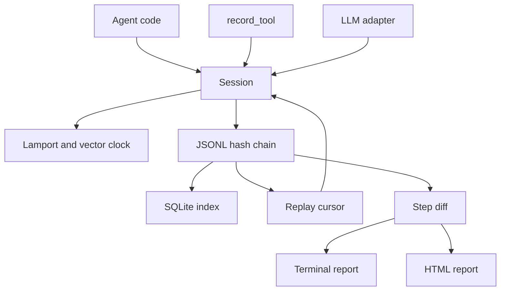

# agent-flight-recorder

The `afr` CLI is a local flight recorder for LLM agent runs.

[](https://github.com/LXP86050/agent-flight-recorder/actions/workflows/ci.yml)
[](LICENSE)

An agent bug is usually one step. The model picked a tool, or the code filled in the wrong argument, and everything after that is fallout. By the time you are looking, the model may not say the same thing again and the tools may not return the same data. This library appends every model call, tool call, seed, and error to a tape. Replay serves those responses back, so the failed run can happen again. Diff shows the first step where two runs are not the same.

It is a library and a command line tool. There is no collector and no service to run.

## Install

Python 3.11 or newer.

```bash
pip install -e ".[dev]"
```

The package is not published. Install it from a checkout. `afr` is the command.

## Demo

`examples/refund_agent.py` is a support agent. The model only chooses the tool. The agent fills in the refund amount, and the buggy policy refunds the whole order (4200 cents) instead of the keyboard the customer named (1500 cents). The idempotency key comes from `session.rng(17)`, so it is part of the tape.

```bash
python examples/demo.py
```

From a run on 2026-11-14:

```text
buggy   12777365787de5cb  refund 4200
replay  f246145f4675755c  logical match, model and tools not called
fixed   de2403f54f57dbbf  refund 1500
pinned  c1cd84af2f50bc15  replay through seq 2, then the fix

a  12777365787de5cb  refund-agent  ok
b  de2403f54f57dbbf  refund-agent  ok
first divergence at seq 4 tool refund: arguments differ (amount_cents: 4200 -> 1500)
 a   b   a step              b step              note
───────────────────────────────────────────────────────────────────────────────────────────────
 0   0   seed random         seed random
 1   1   llm support-mock    llm support-mock
 2   2   tool search_order   tool search_order
 3   3   llm support-mock    llm support-mock
 4   4   tool refund         tool refund         arguments differ (amount_cents: 4200 -> 1500)
 5   5   llm support-mock    llm support-mock    inputs differ
 6   6   seal seal           seal seal
```

The lookup (seq 0 through 2) matches. The model asks for the same refund either way. The agent then passes a different `amount_cents`. Seq 5 differs because the following model call sees that tool result. A fresh run prints different durations; the amounts and the divergence are the same.

Full replay does not call the model and does not run the tools. `AFR_MODE=fixed` is the corrected policy. Replaying the whole buggy tape with the fix stops, because the refund arguments no longer match:

```text
$ AFR_MODE=fixed afr replay 12777365787de5cb
replay diverged at seq 4: tool refund inputs differ
```

That exit status is 1. To try the fix from the failure point, serve the tape through the lookup and then go live:

```bash
AFR_MODE=fixed afr replay 12777365787de5cb --until 2
afr diff 12777365787de5cb <new-run>
```

`--until` is inclusive. Seq 2 is the `search_order` result, taken from the tape. The next model call and the refund tool run for real. In the demo, that second run refunds 1500 cents and the diff's first row is the same refund argument change.

## Library

The demo is the program to run. The calls it makes look like this:

```python
with Recorder(".afr") as recorder:
    with recorder.session("refund-agent", entrypoint="examples/refund_agent.py:main") as session:
        rng = session.rng(17)
        completion = session.complete(
            llm,
            messages=messages,
            model="support-mock",
            temperature=0,
            seed=17,
        )
        for call in completion.tool_calls:
            search_order(**call.arguments)
```

`@record_tool` records the call when a session is active and calls the function directly otherwise. `session.call_tool("search_order", order_id="A184")` does the same lookup by name.

Replay from the library, which is what `examples/demo.py` does for the pinned run:

```python
with recorder.replay(run_id, until=2) as session:
    run_agent(session, llm, bug=False)
```

Until the cutoff, `session.complete` and recorded tools return the taped values. After it, they call the objects you passed in. `session.live` is true once that happens.

Parallel branches share the frontier from when the block opened, so their steps are concurrent whether `do` runs inline or on a worker thread. A thread that is still inside `do` when the block exits raises.

```python
with session.parallel() as block:
    block.do("inventory", lookup_inventory)
    block.do("policy", lookup_policy)
```

`OpenAICompatLLM` posts to `{base_url}/chat/completions`. The default base URL is `https://api.openai.com/v1`. The key comes from the constructor or `OPENAI_API_KEY`. The CI test points this adapter at a local fake server. It does not call a hosted model. There is no streaming.

## CLI

Tapes go in `.afr`, or the directory given by `--dir` or `AFR_DIR`. Run ids can be abbreviated when the prefix is unique.

```text
$ afr list
 run                created               name           steps   status
────────────────────────────────────────────────────────────────────────
 c1cd84af2f50bc15   2026-11-14 21:01:03   refund-agent   7       ok
 de2403f54f57dbbf   2026-11-14 21:01:03   refund-agent   7       ok
 f246145f4675755c   2026-11-14 21:01:03   refund-agent   7       ok
 12777365787de5cb   2026-11-14 21:01:03   refund-agent   7       ok
```

```text
$ afr show 12777365787de5cb
run 12777365787de5cb  refund-agent  7 steps  ok  2026-11-14 21:01:03Z
entrypoint examples/refund_agent.py:main
chain intact
 seq   lamport   kind   name           dt       tokens   note
───────────────────────────────────────────────────────────────────────────────────────────────────────────────────
 0     1         seed   random         1.9us             seed=17
 1     2         llm    support-mock   30.1us   54/3     call search_order
 2     3         tool   search_order   3.7us             order_id=A184
 3     4         llm    support-mock   22.1us   117/1    call refund
 4     5         tool   refund         2.8us             amount_cents=4200 idempotency_key=rf-547339 order_id=A184
 5     6         llm    support-mock   29.0us   180/7    Refunded 4200 cents on A184.
 6     7         seal   seal           0ns               ok
```

`dt` is how long the recorder spent around that step in this run. The token fields on the demo's model calls are filled by the mock from the size of the request and the reply, not by a hosted model. `--causal` adds the parent step ids.

`afr diff <runA> <runB>` prints the table above and exits 1 when the runs differ, 0 when they do not. `--html report.html` writes the same comparison. `afr export <run> --html trace.html` writes one tape. Both files are self-contained.

`afr replay <run> --until N` imports the entrypoint stored on the tape (`path.py:function` or `module:function`) and calls it with the recorder. The entrypoint's `recorder.session()` is the replay. Pass `--entry` when the tape has none.

## How a run is stored



One run is one file, `runs/<run_id>.jsonl`. The first line is a header. Each later line is a step whose `prev` is the sha256 of the previous line. A step id is the sha256 of the logical call: run, kind, name, actor, parent ids, and input. The output is not part of the id. Appending the same id with the same body is a no-op, including across process restarts, so a retry after a crash does not duplicate the step. Appending the same id with a different body raises `SealConflict`. Wall-clock timestamps are stored and are not part of that comparison.

The directory holds a lock file. A second `Recorder` on the same directory raises `StoreBusy`. The sqlite file is an index. Opening a recorder rebuilds it from the tapes. The index also remembers the tip hash it last synced. Rewriting the last line of a tape, which the chain alone cannot see, disagrees with that tip. Delete the index and there is no witness left for the tip.

A crash mid-append leaves a partial trailing line. The next open truncates back to the last full line and fsyncs. A run whose file has no seal line is `torn`. A clean exit writes a seal. Replay refuses a tape whose chain does not check out.

Ordering inside a run is a Lamport clock plus a vector clock. `session.parallel()` snapshots the current frontier for each branch and gives that branch its own clock component. Those steps are concurrent. The next step on the session actor happens after all of them. Parent ids are the frontier at the time the step was recorded, so the happens-before relation can be read back without trusting the append order of concurrent steps.

Replay walks the tape in seq order, skipping the seal. The next agent call has to match the next step's kind, name, and canonical input. A mismatch raises `ReplayDivergence` and names the seq. It does not look further down the tape. `--until N` serves steps with `seq <= N`. The following call, and every call after it, uses the live adapter and the live tools.

## Design choices

The tape is the record and the index is disposable. A flight recorder is read after something has already gone wrong, which is a bad time to find that the log rewrote an earlier line or tore the last one. Fsync on each append is the cost of that. Agent runs are not a high-frequency log.

Step ids hash the call, not the whole line. Two attempts to record the same call agree, and a changed output is an explicit conflict instead of a second copy that quietly diverges.

Replay is a cursor with an equality check, not a search. Realigning a drifted agent onto a later similar step would hide the bug. Failing at the first different input is the useful behavior. The cutoff is one-way because the live suffix is a new run, not a splice back into the old tape.

Vector clocks are there for parallel tool calls, and so that a later version can merge tapes from more than one process without inventing a false order. This version does not do that merge. The clocks are still written, and `afr show --causal` prints the parents.

Diff aligns on kind, name, and the hash of the input. The same call with a different result is reported as an output change. The same tool name with a different argument is reported as an argument change, with the fields that moved. Timing and token counts are not part of the comparison.

## Limitations

- One writer per directory. Tapes are local files.
- Replay will not skip ahead. If you change code that affects an input before the cutoff, replay stops.
- Served steps do not execute the tool or the model. Side effects that already happened are not rolled back. They are avoided only when you replay instead of running the tool again.
- A failed step is re-raised as `RecordedFailure`. The original exception type is not reconstructed.
- The chat adapter does not stream, and it only speaks the chat-completions request. Tool arguments must be a JSON object.
- The hash chain plus the index tip will show an edit. They are not a signature. Someone who can rewrite both files can recompute them.
- Other sources of randomness are invisible unless the agent takes them from `session.rng`.
- Opening a recorder rereads every tape to rebuild the index.

## Roadmap

- Merge tapes recorded in separate processes. The vector clocks are the hook; the merge does not exist yet.
- Sign the tip, so a tape can be checked by someone who does not hold the index.
- Record a streamed model response as it arrives, instead of one step after the call returns.
- A single-file export of one run, for attaching to a bug report. `afr export --html` is a view, not that bundle.

## Development

```bash
pip install -e ".[dev]"
ruff check .
ruff format --check .
mypy
pytest
```

## License

MIT. Copyright 2026 Lokesh Pulivarthi.
